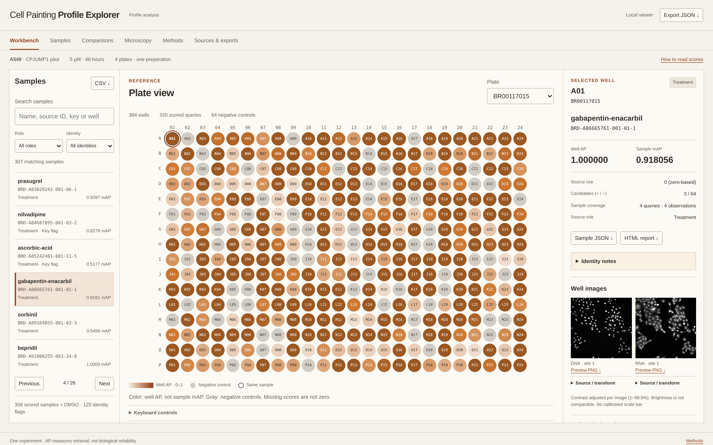

# Cell Painting Profile Explorer

Explore how cell-profile retrieval changes with normalization, well position, plate omission and feature removal. Select a well, inspect its sample, and compare the results alongside the available microscopy.



## Open the explorer

Open [index.html](index.html) in a browser. No installation or connection is needed. Keep the extracted folders together.

For an optional local server with Python 3.10 or newer:

```sh
python -B scripts/serve_explorer.py --port 8785
```

Visit `http://127.0.0.1:8785`. See [Quick start](docs/QUICK_START.md) for controls and exports.

## What is included

The explorer covers **1,536 wells across four A549 CPJUMP1 plates**, with 306 scored sample labels and a separate DMSO control group. Browse 15 analysis variants, 17 comparisons, sample reports, full-precision CSV/JSON exports, and four microscopy previews from two wells.

The reproduced reference agrees numerically with the selected published calculation. Removing a plate largely preserves sample ordering but changes individual scores. Control-based normalization produces larger changes in scores and ordering. [Read the findings](docs/SCIENTIFIC_SYNTHESIS.md).

## Interpreting the results

All four plates come from **one experiment**. AP and mAP measure retrieval, not drug effectiveness or a probability of biological reliability. Repeated well positions and flagged chemical identities remain visible. Microscopy is shown only for the exact wells with packaged images.

This repository contains the **viewer and saved results**, not the executable scientific analysis pipeline. [Methods](docs/METHODS.md) and [Reproducibility](docs/REPRODUCIBILITY.md) describe the calculation, input versions and boundaries.

## Sources and license

Experimental data and the reference workflow come from [Chandrasekaran et al., CPJUMP1](https://www.nature.com/articles/s41592-024-02241-6), [Cell Painting Gallery](https://github.com/broadinstitute/cellpainting-gallery), and [copairs](https://github.com/cytomining/copairs). See [Provenance](docs/PROVENANCE.md) for exact source versions.

The [MIT License](LICENSE) covers project-owned viewer code and prose. Data, images and third-party material retain their separate terms in [License scope](LICENSE_SCOPE.md).
